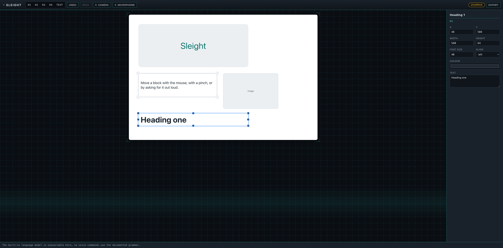
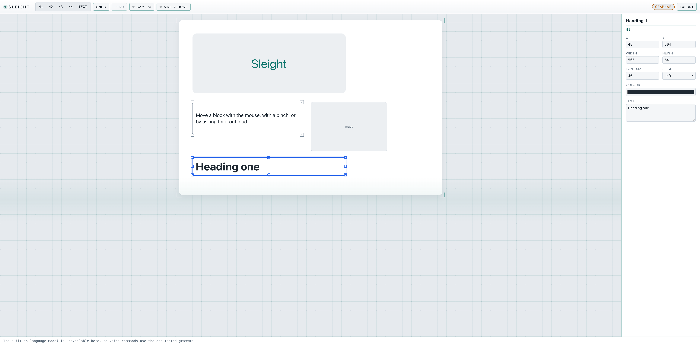
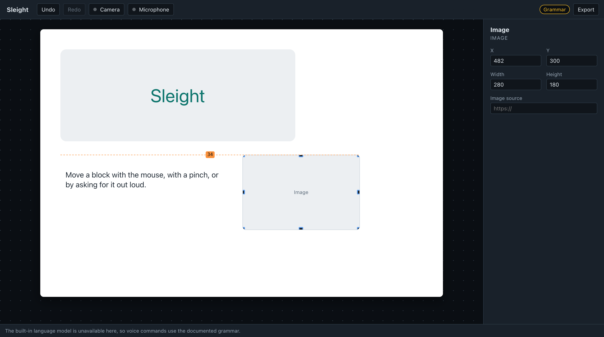
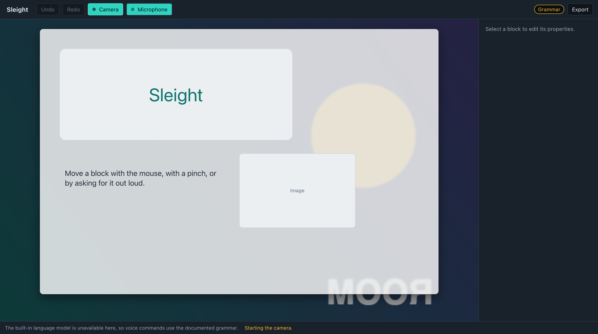
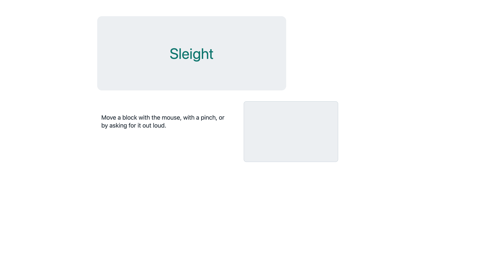

# Sleight

Sleight is a block layout editor with three interchangeable input sources. The
same document can be edited with a mouse, with a hand tracked through the
webcam, or by speaking, and all three can be used at the same moment without
waiting on each other. It exports a standalone HTML page.

## Live demo

Not yet deployed. See [Deploying](#deploying) — the build is production ready and
the URL goes here once the project is imported.

## Screenshots

The editor in dark and light schemes. Every surface resolves through the token
file, and the document canvas deliberately stays on a fixed paper surface in both
— block colours are content that ships in the export, so they have to stay
legible against the background the exported page will use. The instrument chrome
around it is the one place the two schemes are free to diverge.





Snap guides and distance labels are drawn on the overlay canvas during a drag,
and never reach the export.



With the camera on, the document floats over the live feed.



The same document exported as a standalone HTML file, opened directly from disk.



## Browser requirements

Sleight is usable in any modern browser with a mouse. The other two input
sources have real requirements, and the application degrades in tiers rather
than failing.

Hand tracking needs a webcam and a Chromium-based browser, and a secure context
(`localhost` or `https`). It is never started automatically: the camera opens
only when the Camera control is switched on, and the control is hidden entirely
where `getUserMedia` is unavailable.

Natural-language voice commands need the browser's built-in `LanguageModel`,
which is available in Chrome 148 and later on desktop and requires an official
Google Chrome build. Chromium packages from Linux distributions ship without the
inference component and report `unavailable` regardless of hardware. Edge,
Firefox, and Safari do not support it at all.

The active tier is detected at runtime and stated in the toolbar and the status
bar. There is no capability error to interpret.

| Tier    | Requirement                      | Voice behaviour                                                  |
| ------- | -------------------------------- | ---------------------------------------------------------------- |
| Full    | `LanguageModel` available        | Natural-language commands, with the grammar as a fallback        |
| Grammar | Speech recognition, but no model | The documented grammar handles a fixed set of phrasings          |
| Manual  | No speech recognition            | Voice controls are hidden; mouse and hand editing are unaffected |

Every tier works with the network disconnected after first load, with one
exception: GIF search calls the Giphy API. Everything else — editing, the
grammar, the model, hand tracking, export, persistence — runs on the machine.
Speech recognition itself may use a network service depending on the browser.

## GIF search

An image block can be filled from a spoken query, and the result browsed until
one is worth keeping. This is the only feature that leaves the machine, and it
is the only one that needs a key:

```
echo 'VITE_GIPHY_KEY=your-key-here' > .env.local
```

Without a key the feature reports itself as unconfigured in the status bar and
changes nothing; the rest of the editor is unaffected. `.env.local` is ignored
by git, so no key is ever committed. Requests carry the search term and nothing
else — no document content and no identifier.

## Architecture

```
src/
  core/        block tree, reducer, store, intent bus, property locks
  adapters/    pointer, hand, and voice input translated into intents
  vision/      hand landmark inference in a worker, one euro filtering
  language/    speech capture, deterministic grammar, on-device model parsing
  media/       gif search, the one service outside the machine
  render/      dom renderer, overlay canvas, standalone html export
  ui/          toolbar, inspector, design tokens
```

Dependencies point strictly inward. `adapters/`, `render/`, `language/`, and
`ui/` all depend on `core/`; `core/` depends on nothing. An import running the
other way is an architecture violation, not a shortcut.

### One intent, three sources

The single decision the rest of the codebase rests on is that no input source
talks to the document. Each one produces the same value and hands it to a bus:

```ts
type Intent = {
  cmd: Command
  source: 'pointer' | 'hand' | 'voice'
  txn?: string // groups a continuous gesture into one undo step
  ts: number
}
```

A mouse drag, a pinch, and the sentence "make it wider" all arrive as a
`nudge` command on the same path. Nothing downstream can tell them apart, so
hover highlighting, selection, undo grouping, and the renderer are written once
and behave identically in every mode. Adding a fourth source would mean writing
one adapter and changing nothing else.

`PropPath` is a closed union — `'x' | 'y' | 'w' | 'h' | 'color' | 'fontSize' |
'align' | 'src' | 'text'` — and `set` is distributed over it, so a command that
pairs the wrong value with a path does not compile.

### The property lock table

Two sources editing at once is the interesting case, and resolving it globally
would be wrong: a single editor-wide lock would mean a resize gesture blocks
every spoken command until the hand opens. Sleight resolves contention per
property group instead.

| Group     | Paths                        |
| --------- | ---------------------------- |
| `geom`    | `x`, `y`, `w`, `h`           |
| `style`   | `color`, `fontSize`, `align` |
| `content` | `src`, `text`                |

The rules are:

- A continuous gesture leases `${blockId}:${group}` for the length of its
  transaction, renewed by every intent it emits.
- An intent from a different transaction targeting a leased key is deferred if
  it came from voice, and dropped otherwise. Voice waits because an utterance is
  expensive to produce and nobody wants to repeat it; a pointer or hand sample is
  dropped because another one arrives a frame later.
- The deferred queue drains in FIFO order the moment the lease is released.
- Leases expire after 1500ms. A gesture that stops emitting — camera occlusion,
  a dropped pointer capture, a closed lid — must not be able to deadlock the
  document, so an expiry timer frees the key and drains the queue without it.

This is what makes the defining scenario work. Resizing the hero holds
`hero:geom`; saying "change the text color to teal" mid-gesture takes
`hero:style`. Different keys, no contention, both land. Say "set the width to
900" during the same gesture and it targets `hero:geom` instead, so it waits and
applies the instant the pinch opens.

The lock table also pays for itself in the undo stack. History is stored as a
list of transactions rather than document snapshots, and undo drops the last
transaction and replays the rest. That is only correct if concurrent
transactions commute — which the lock table guarantees, because it never lets two
of them touch the same property group.

### Undo groups by transaction

One pinch-drag emitting forty `nudge` commands is one undo step, because all
forty carry the same `txn`. A voice command issued during that drag carries no
`txn` of its own and becomes a separate step, ordered by its own timestamp, so
undoing it leaves the drag intact.

## Why DOM for the document and canvas for the overlay

The document renders to DOM. The output of this editor is an HTML page, so the
editing surface and the export should be the same primitive — text layout,
`contenteditable`, and accessibility all come free, and export is serialisation
rather than translation. There is no framework: the renderer writes to the DOM
directly and reads live layout through `elementFromPoint`, and a virtual DOM
would both fight that and add reconciliation to the per-frame path.

The overlay renders to a Canvas 2D surface sitting above the document with
`pointer-events: none`. The hand cursor, the dwell ring, and the snap guides are
per-frame graphics that must never appear in the export, and keeping them on a
separate surface means the export needs no cleanup pass at all — there is
nothing to strip, because those pixels were never part of the document.

Selection and hover outlines are `::after` pseudo-elements on the block itself,
so their geometry follows layout with no measurement, and the highlight is
identical whether a mouse or a hand produced it.

## The editor chrome

The chrome is styled as an instrument panel: a grid behind the page, corner
brackets around it, a light travelling under the toolbar, and a slow band
crossing the stage. All of it is drawn from the `--sl-hud-*` tokens, which are
separate from the paper tokens that describe the document. That separation is
the point — the page being authored keeps a neutral background in both colour
schemes, because those pixels ship in the export and the editor's own styling
must never reach them.

Everything that moves does so under two constraints. Animations run on
`transform` and `opacity` only, so the compositor handles them and a drag never
competes with them for paint. And every one of them is turned off under
`prefers-reduced-motion: reduce`, including the turning reticle around the hand
cursor, which is drawn on canvas and so reads the media query in JavaScript
rather than in a stylesheet.

Two rules keep the per-frame path cheap:

- Hit testing runs exactly once per frame inside the rAF loop, never per event.
  `elementFromPoint` forces a style flush, and calling it on every pointer move
  costs frames during a drag for a result that cannot change more than once a
  frame anyway.
- Hover damping is applied to the hand only. A smoothed hand point grazes blocks
  it is merely passing over, so a candidate must be held for 120ms before it is
  committed and the point must clear the current block by 8px before it is
  released. The mouse is deliberately exempt: the same debounce makes a mouse
  feel broken.

## Hand tracking

Landmark inference runs in a module worker, using MediaPipe's HandLandmarker
compiled to WebAssembly. Only the ES module build of that runtime is vendored,
because a module worker has no `importScripts` and cannot load the CommonJS build
MediaPipe would otherwise fall back to. The main thread receives only `{ x, y, pinch, confidence }`;
landmarks never cross the boundary. Inference on the main thread would contend
with layout during exactly the drags it is meant to drive.

The tracked point is the midpoint of thumb tip and index tip, so closing the
pinch does not drag the cursor off the thing being grabbed. It is smoothed with a
One Euro filter rather than a moving average or a lerp: a fixed smoother forces
one choice for the whole gesture, steady enough to hold still or responsive
enough to move fast, never both. One Euro varies its cutoff with observed speed
and gives both.

Pinch detection uses hysteresis — close at a normalised distance of 0.045, open
at 0.065. A single threshold sits exactly where the signal is noisiest and
produces phantom releases in the middle of a drag. A dwell click is available as
an accessibility fallback: hold the cursor inside a 20px circle for 600ms, with a
progress ring giving continuous feedback. Below 0.6 tracking confidence the
cursor is hidden rather than drawn, because a cursor that wanders on its own is
worse than no cursor.

### Gestures

| Gesture                                      | Effect                                |
| -------------------------------------------- | ------------------------------------- |
| One hand pinched on a block                  | Moves it, the way a pointer drag does |
| One hand pinched on a resize handle          | Resizes from that edge or corner      |
| Both hands pinched, moving apart or together | Scales the block about its centre     |
| Both hands pinched, travelling together      | Pans the block                        |
| One hand held still for 600ms                | Selects, as a dwell click             |

A pinch closed over a resize handle grabs that handle instead of the block, and
goes through the same handle maths the mouse uses, so a north or west handle
moves the origin as it grows the block in either mode.

Two pinched hands are the tablet gesture: the distance between them sets the
size and their midpoint sets the position, both at once. The scale is written as
absolute values computed from the geometry captured when the gesture started,
not as accumulated per-frame deltas — a dropped frame then costs nothing, where
accumulating would leave the block a little further out of place after every
gesture. The whole gesture is one transaction, so it is one undo step.

Both hands are tracked with a One Euro filter each, keyed by handedness. Sharing
one filter would make each hand yank the other's smoothed position every time
they swap places in the model's result list, which happens constantly when both
are in frame.

While the camera is on, the feed is drawn behind the canvas and the page turns
translucent over it, so the layout appears to float in the room in front of you.
The feed is already running for inference, so this costs one compositor layer
and no extra capture. It is mirrored to match the cursor mapping. The veil
opacity and feed opacity are tokens, because how much room to let through is a
legibility trade-off rather than a fixed answer.

Every value tuned by feel lives in `src/tuning.ts`, each with a comment saying
what goes wrong when it moves in either direction. Colour and opacity values
live in `src/ui/tokens.css` for the same reason.

## Voice command reference

Property commands act on the current selection and are ignored when nothing is
selected. Filler openings (`please`, `okay`, `hey`, `now`) and trailing
punctuation are stripped before parsing, and anything that does not match
produces no command at all rather than a guess — so conversation near an open
microphone does not edit the document.

| Say                                               | Effect                                     |
| ------------------------------------------------- | ------------------------------------------ |
| `change the text color to teal`                   | Sets the text colour                       |
| `change the colour to navy`                       | Same, British spelling accepted            |
| `set the color to #ff8800`                        | Accepts a hex literal, three or six digits |
| `change the font size to 32`                      | Sets type size in pixels                   |
| `set the width to 500`                            | Sets width in pixels                       |
| `set the height to 240`                           | Sets height in pixels                      |
| `make it bigger` / `make it wider`                | Widens the block                           |
| `make it smaller` / `make it narrower`            | Narrows the block                          |
| `make it taller` / `make it shorter`              | Changes height                             |
| `make the text bigger` / `make the text smaller`  | Changes type size, not the box             |
| `align left` / `align center` / `align right`     | Sets alignment                             |
| `center it`                                       | Centres the text                           |
| `select the hero` / `select the image`            | Selects the first block of that type       |
| `select the second heading`                       | Counts blocks of that type in canvas order |
| `select the last paragraph`                       | Takes the final one instead of the first   |
| `select intro copy`                               | Matches the block's label                  |
| `select the next block` / `select the previous`   | Walks the canvas, wrapping at the ends     |
| `deselect`                                        | Clears the selection                       |
| `add a heading` / `add an h3`                     | Inserts a heading; a bare heading is an h1 |
| `add a paragraph` / `insert a picture`            | Inserts a block of that type               |
| `delete it` / `remove this`                       | Deletes the selection                      |
| `delete the image` / `get rid of the last block`  | Deletes the block that is named            |
| `make the second heading wider`                   | Acts on a named block, not the selection   |
| `change the image's width to 300`                 | A possessive names the block too           |
| `rotate it 30 degrees`                            | Turns by a step; `to 90` turns to an angle |
| `rotate the image left 45 degrees`                | Turns the other way                        |
| `straighten it`                                   | Returns the block to level                 |
| `bold it` / `make it italic` / `underline it`     | Switches a text style on                   |
| `unbold it` / `remove the underline`              | Switches one off                           |
| `find a gif of a cat`                             | Fills the image block from a search        |
| `change it` / `another one`                       | The next result for the same search        |
| `randomize` / `surprise me`                       | Any other result for the same search       |
| `keep it`                                         | Ends the browse and keeps what is showing  |
| `undo` / `redo`                                   | Moves through history                      |
| `change the text to Welcome aboard`               | Replaces the block's text                  |
| `set the source to https://example.com/photo.jpg` | Points an image block at a URL             |

A target can be named four ways, tried in that order: a pronoun (`it`, `this`),
a position (`first`, `last`, `next`, `previous`), a type with an optional
ordinal (`the second h2`), and finally the block's own label. The label comes
last because labels are free text and would otherwise shadow the fixed
vocabulary the rest of the grammar depends on.

The same target phrases work inside a property or delete command, so a block can
be edited without selecting it first. The property is read from the end of the
phrase and everything before it is the target, matched longest first — which is
what keeps `change the text colour` a property change on the selection rather
than a colour change aimed at the first text block on the canvas.

Units are optional: `32`, `32 pixels`, and `32px` are equivalent. Recognised
colour names are black, white, grey, gray, silver, slate, navy, blue, sky, cyan,
teal, emerald, green, lime, olive, yellow, amber, gold, orange, coral, red,
maroon, crimson, pink, rose, magenta, purple, violet, indigo, and brown.

In the Full tier the built-in model handles freer phrasing than this and falls
back to the table above whenever it cannot produce a valid command. The full
grammar, including what it deliberately refuses, is in
[docs/voice-commands.md](docs/voice-commands.md).

## Running locally

```
npm install
npm run dev
```

The camera requires a secure context, so hand tracking works on `localhost` and
over `https`, but not over plain `http` to another host.

Other scripts:

```
npm run build      # production build into dist/
npm run typecheck  # tsc --noEmit
npm test           # unit tests
npm run lint       # eslint
```

`npm install` and `npm run build` copy the MediaPipe vision runtime out of
`node_modules` into `public/models/wasm`, so the app loads its inference runtime
from its own origin.

## Deploying

Import the repository on Vercel. The included `vercel.json` sets the build
command to `npm run build` and the output directory to `dist`, and marks
everything under `/models/` as immutable for a year. All inference is on device,
so the only environment variable is `VITE_GIPHY_KEY`, and it is optional: without
it every feature except GIF search behaves identically.

## Known limitations

- Documents persist to `localStorage` only. There is no account, no sync, and no
  server; clearing site data clears the page. This is deliberate for a proof of
  concept and is the first thing that would change.
- Nine block types: `section`, `hero`, `h1` to `h4`, `paragraph`, `text`, and
  `image`. Headings and paragraphs carry their real tag through to the export.
- Bold, italic, and underline apply to a whole block, not to a run of words
  inside it. There is no rich text model; a block has one set of styles.
- Blocks are added from the toolbar or by voice, and deleted by voice only.
  There is no delete control in the interface, so a session without a working
  microphone can add a block but not remove it except by undoing.
- The canvas is a fixed 960 by 640 and nothing can resize it. Once a page is
  full, a new block cascades over what is already there rather than extending
  the page, and has to be dragged somewhere useful.
- No collaborative editing. The lock table resolves contention between input
  sources on one machine, not between people.
- The two-hand gesture scales and pans but does not rotate. Blocks now carry a
  rotation, set from the inspector or by voice, but no gesture turns one: that
  needs a third relationship read from the pair of hands, on top of the span and
  the midpoint already in use.
- No responsive breakpoints. The canvas is a single fixed-size surface and the
  export is absolutely positioned at that size.
- Hand tracking degrades in low light and near the frame edges. The usable middle
  70% of the camera frame is stretched across the canvas for that reason, which
  trades precision for reach.
- The on-device model is small. It is used only to classify an utterance into a
  fixed command vocabulary, which is well within it. It is not asked to reason
  about layout or aesthetics, and it should not be.
- The vendored vision assets are large: about 20 MB in `dist`, of which 7.5 MB is
  the hand landmarker model and 12 MB is the WebAssembly runtime. The application
  code itself is 15 kB gzipped, plus 45 kB gzipped for the worker. Nothing under
  `/models/` is fetched until the camera is switched on.
- GIF search is the one feature that depends on a third party. It needs a Giphy
  key, it needs a connection, and both of those are things the rest of the
  application deliberately does without. Nothing else regressed to accommodate
  it: the library reports an outcome instead of throwing, and every failure
  leaves the document untouched.
- A rotated block is still resized along screen axes, not its own. Dragging a
  handle on a block turned 45 degrees moves the edge in the direction the mouse
  moved rather than the direction the edge faces. Snap guides measure the
  unrotated box for the same reason.
- Offline behaviour depends on the HTTP cache rather than a service worker.
  Editing, voice through the grammar, the inspector, export, and persistence all
  work with the network disconnected after first load. Hand tracking does too,
  but only once the vision assets are in the cache — and they are only fetched
  when the camera is first switched on. Enable the camera once while online and
  the `immutable` header in `vercel.json` keeps them available offline for a
  year. Precaching them behind a service worker would close that gap.
- Keyboard access covers the editor chrome: the toolbar and every inspector field
  are reachable and operable by keyboard, and each control carries a label.
  Blocks on the canvas cannot yet be selected or moved from the keyboard; that
  needs a roving focus model the canvas does not have.

## License

MIT
